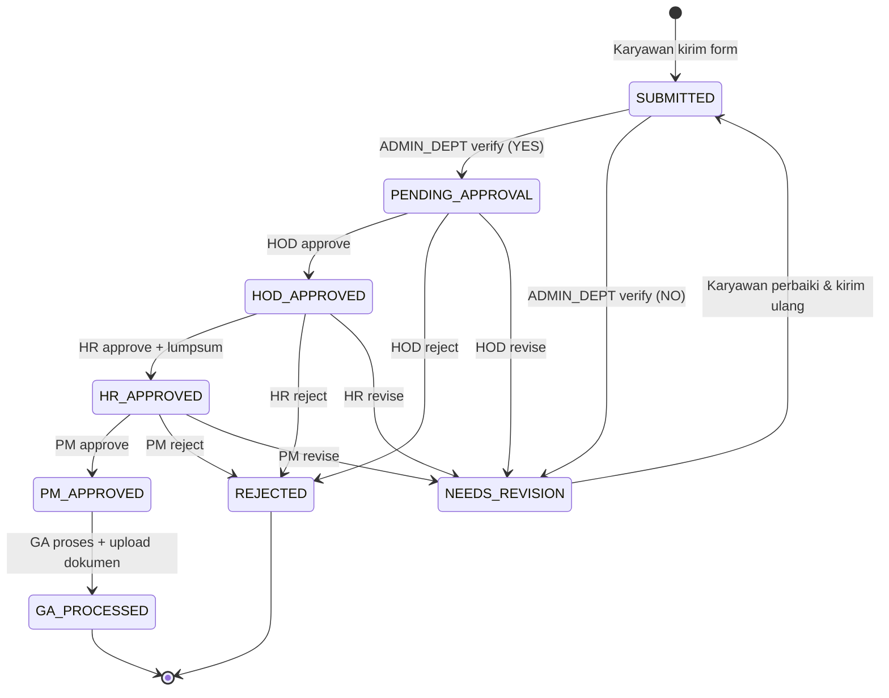

# Workflow TRF

Sumber utama: `apps/web/src/workflow/trfWorkflow.ts` (`getNextStatus`), `apps/web/src/store/index.ts` (`handleVerify`, `handleApproval`, `findNextActiveStatus`, `resubmitTRF`, `editAndApproveTRF`, `deleteTRF`), `apps/web/src/store/supabaseStore.ts` (`gaProcessTRF`, `saveHRLumpsum`). [kode]

## Status

| Status | Arti | Dipakai oleh jalur aktif? |
|---|---|---|
| `DRAFT` | Disimpan, belum dikirim | Sistem lama: form tidak pernah membuat DRAFT. **Sejak D9:** "Simpan draft" membuat DRAFT yang bisa diedit/dihapus pemilik |
| `SUBMITTED` | Dikirim karyawan, menunggu Admin Dept | ✅ |
| `PENDING_APPROVAL` | Sudah diverifikasi Admin Dept, menunggu HOD | ✅ |
| `ADMIN_DEPT_VERIFIED` | Alternatif dari `PENDING_APPROVAL` di kode lama | ❌ Hanya dipakai `supabaseStore.ts` (jalur yang tidak dipanggil halaman) dan label UI |
| `HOD_APPROVED` | Disetujui HOD, menunggu HR | ✅ |
| `HR_APPROVED` | Disetujui HR, menunggu PM | ✅ |
| `PM_APPROVED` | Disetujui PM, menunggu GA | ✅ |
| `GA_PROCESSED` | Tiket/voucher sudah diproses GA. **Selesai** | ✅ |
| `REJECTED` | Ditolak. **Selesai** | ✅ |
| `NEEDS_REVISION` | Dikembalikan ke karyawan untuk diperbaiki | ✅ |
| `REVISED` | Ada di tipe dan label, tidak pernah ditulis | ❌ |
| `CANCELLED` | Dibatalkan pemilik dengan alasan (D9). **Selesai** | ✅ |
| `APPROVED` | **Tidak ada di daftar status**, tetapi bisa ditulis oleh jalur skip approver | ⚠️ Lihat catatan skip approver di bawah |

## Diagram alur

## Tabel transisi (yang benar-benar bisa dilakukan lewat UI)

| Dari | Aksi | Peran | Ke | Syarat tambahan |
|---|---|---|---|---|
| — | Buat TRF | EMPLOYEE, SUPER_ADMIN | `SUBMITTED` | Lolos validasi form ([trf-data.md](trf-data.md)) |
| `SUBMITTED` | Verify YES | ADMIN_DEPT (department sama) | `PENDING_APPROVAL`* | — |
| `SUBMITTED` | Verify NO | ADMIN_DEPT | `NEEDS_REVISION` | Remarks opsional |
| `PENDING_APPROVAL` | Approve | HOD (department sama) | `HOD_APPROVED`* | — |
| `HOD_APPROVED` | Approve | HR | `HR_APPROVED`* | **Wajib pilih lumpsum** dari daftar resmi. Lumpsum disimpan **sebelum** status berubah, dalam request terpisah |
| `HOD_APPROVED` | Edit & Approve | HR | `HR_APPROVED`* | HR boleh mengubah isi TRF sekaligus menyetujui. Karyawan mendapat notifikasi in-app |
| `HR_APPROVED` | Approve | PM | `PM_APPROVED`* | — |
| `PM_APPROVED` | Edit | GA | `PM_APPROVED` (tetap) | Hanya edit isi. Tercatat di history dengan status lama = status baru |
| `PM_APPROVED` | Process | GA | `GA_PROCESSED` | Upload dokumen tiket/voucher ke Storage |
| `PENDING_APPROVAL` / `HOD_APPROVED` / `HR_APPROVED` | Reject | HOD / HR / PM | `REJECTED` | Sistem lama: tanpa konfirmasi dan tanpa alasan. **Sejak D10:** alasan wajib, dialog konfirmasi, alasan dikirim ke karyawan |
| sama seperti di atas | Revise | HOD / HR / PM | `NEEDS_REVISION` | Remarks wajib |
| `NEEDS_REVISION` | Kirim ulang | EMPLOYEE | `SUBMITTED` | Isi form diganti seluruhnya. Kembali ke Admin Dept dari awal |
| `DRAFT` | Hapus | Pemilik (D9) | — dihapus | Hanya DRAFT. Sejak migrasi `0011`, database juga menolak penghapusan TRF selain DRAFT |
| Belum `GA_PROCESSED`/`REJECTED`/`CANCELLED` | Batalkan | Pemilik | `CANCELLED` | Alasan wajib, tercatat di riwayat (D9) |

\* **Skip approver** (`findNextActiveStatus`): setelah VERIFY/APPROVE, kalau di daftar `users` yang sudah dimuat browser **tidak ada user aktif** dengan peran tahap berikutnya, tahap itu dilewati otomatis, maksimal sampai `APPROVED`. Pengecekan department hanya dilakukan untuk `ADMIN_DEPT`, padahal tahap yang dicek adalah HOD, HR, PM, dan GA. Jadi HOD dari department mana pun dihitung aktif. **Diganti oleh D2:** tidak ada lagi skip otomatis. TRF ditahan di tahapnya sampai ada approver aktif (HOD harus dari department yang sama), dan SUPER_ADMIN melihatnya lewat `blockedBy`.

## Aturan `getNextStatus`

Fungsi murni ini menentukan status berikutnya, dan melempar error kalau kombinasinya tidak sah.

- **APPROVE/VERIFY**: hanya lima pasangan yang sah: `ADMIN_DEPT+VERIFY+SUBMITTED`, `HOD+APPROVE+PENDING_APPROVAL`, `HR+APPROVE+HOD_APPROVED`, `PM+APPROVE+HR_APPROVED`, `GA+APPROVE+PM_APPROVED`. `SUPER_ADMIN` **tidak bisa** approve, meskipun boleh membuka halamannya.
- **REJECT/REVISE**: ADMIN_DEPT di `SUBMITTED`, HOD di `PENDING_APPROVAL`, HR di `HOD_APPROVED`, PM di `HR_APPROVED`, GA di `PM_APPROVED`, dan SUPER_ADMIN di semua status yang masih berjalan.

Tes: `apps/web/src/workflow/trfWorkflow.test.ts` dan `trfWorkflow.characterization.test.ts`.

## Riwayat status

Setiap perubahan status menulis baris `status_history` (`trf_id`, `changed_by`, `changed_by_name`, `old_status`, `new_status`, `remarks`). Di backend baru, perubahan status dan riwayatnya ditulis dalam satu transaksi (ADR-0005). [kode]

Nama pelaku diambil dari data `employees` yang terhubung ke akun. Kalau tidak ada, dipakai `username`.

## Nomor TRF

`trf_number` dibuat trigger database `generate_trf_number`: `TRF-YYYYMMDD-NNNN`, dengan tanggal bisnis WITA (D7) dan nomor urut dari sequence `trf_number_seq` (migrasi `0010`, mulai 1000). Nomor lama tidak diubah.

## Aturan dari dokumen bisnis yang belum ada di kode

- **H-14**: diterapkan sebagai D8 (boleh, tetapi wajib alasan dan diberi tanda Urgent).
- **Simpan draft**: diterapkan sebagai D9.
- **Target proses internal ≤ 4 hari**: tidak diukur di sistem. [dok]
